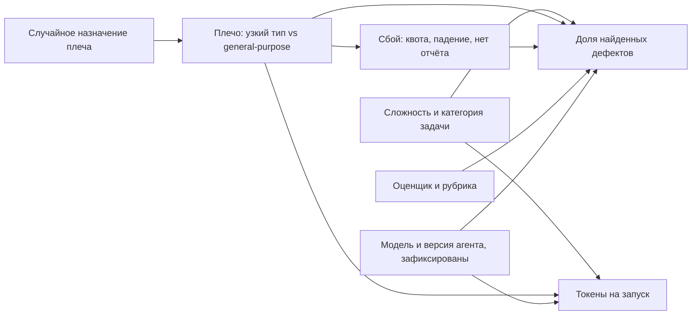

# dag.md — 20261015-narrow-subagent

Причинная схема для вопроса «что изменится, если заменить явный general-purpose на узкий тип на тех же задачах».

## Пояснения к рёбрам

- **R → A.** Единственный источник назначения плеча — рандомизация. Стрелки из T в A нет: задача не выбирает плечо.
- **T → Y, T → K.** Сложность задачи влияет и на находки, и на расход. Это главный конфаундер, который убирает парный дизайн.
- **A → Y, A → K.** Искомые эффекты. Интервенция — связка «набор инструментов + промпт + роль».
- **A → F → Y.** Сбои зависят от плеча через расход токенов и квоты. Путь через F учитывается стратегией treatment-policy (балл 0).
- **G → Y.** Оценщик — часть измерения. Слепота и калибровка снимают путь G ↔ A.
- **M → Y, M → K.** Модель зафиксирована, поэтому не конфаундер, но её отклонение исключает запуск.

Ребра, которых нет намеренно: K → Y (токены не предполагаются причиной качества; это допущение проверяется, а не принимается); A → G (оценщик не знает плеча).

## Проверка по схеме

- Чтобы оценить эффект A на Y, достаточно рандомизации (R → A без обратных путей): конфаундеры по T убираются парным дизайном.
- Путь через F не блокируется; он является частью эффекта, поэтому считается treatment-policy в primary и исключается в sensitivity.
- Путь G → Y закрывается слепотой и калибровкой; если калибровка провалена, оценка Y недостоверна, и вывод не делается.
